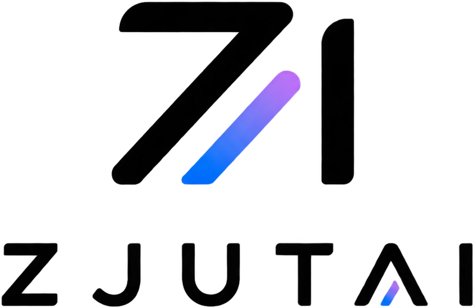

<picture>
  <source media="(prefers-color-scheme: dark)" srcset="logo/zjutai-logo-white.png">
  <source media="(prefers-color-scheme: light)" srcset="logo/zjutai-logo-dark.png">
  
</picture>

# ZJUT AI 品牌素材

浙江工业大学 AI 协会（ZJUT AI）的 logo 与视觉基础规范。所有素材都是**透明底 PNG**，
可以直接叠在海报、公众号封面、PPT、周边物料上，不会带出白框或黑框。

## 用哪个文件

| 放在什么背景上 | 用这个 |
| :--- | :--- |
| 深色、黑色、照片、渐变 | `logo/zjutai-logo-white.png` |
| 浅色、白色、浅灰、米色 | `logo/zjutai-logo-dark.png` |

白字版铺在浅色底上等于看不见，黑字版铺在深色底上也一样。**这是最容易出错的一步。**

## 文件

| 文件 | 尺寸 | 用途 |
| :--- | :--- | :--- |
| `logo/zjutai-logo-white.png` | 807×526 | 深色背景用，已裁掉四周空白 |
| `logo/zjutai-logo-dark.png` | 807×525 | 浅色背景用，已裁掉四周空白 |
| `logo/source/zjutai-logo-white-1254.png` | 1254×1254 | 白版原始文件，四周带留白 |
| `logo/source/zjutai-logo-dark-1254.png` | 1254×1254 | 黑版原始文件，四周带留白 |

日常直接用前两个。`source/` 里是原始导出文件，只有在需要重新裁切或做印刷时才用得上。

> 原始文件为什么是正方形？设计稿画布是 1254×1254，logo 只占中间一块。
> 直接用会导致「明明设了 200px 宽，字却只有 120px」的错觉。

## 三条规则

1. **等比缩放。** 不要单独拉宽或压高。锁定比例再改尺寸。
2. **不要改色。** 蓝紫斜杠和 `ZJUTAI` 里 `A` 的渐变是设计的一部分，不要换成纯色，也不要加描边、阴影、发光。
3. **留出呼吸。** logo 四周至少留出 logo 高度 25% 的空白，不要贴边、不要压在复杂纹理上。

最小使用宽度 **80px**。比这更小时 `ZJUTAI` 字标会糊成一团，建议只用图形部分（会另行提供）。

## 配色

| 名称 | 色值 | 用在哪 |
| :--- | :--- | :--- |
| 品牌紫 | `#DDAEFF` | 渐变起点 |
| 品牌蓝 | `#1A87FF` | 渐变终点 |
| 墨黑 | `#000000` | 黑字版字标、正文 |
| 深底 | `#0E0E12` | 深色封面、海报底色 |

斜杠是**紫到蓝的线性渐变**，不是纯色。需要复刻时按 `#DDAEFF → #1A87FF` 取。

## 授权

版权归浙江工业大学 AI 协会所有。允许用于协会活动宣传、合作方物料和教学示例；
不得用于暗示背书、商标注册或任何商业售卖。完整条款见 [LICENSE.md](LICENSE.md)。

需要矢量源（SVG / AI）或品牌合作，请通过协会官方渠道联系我们。
