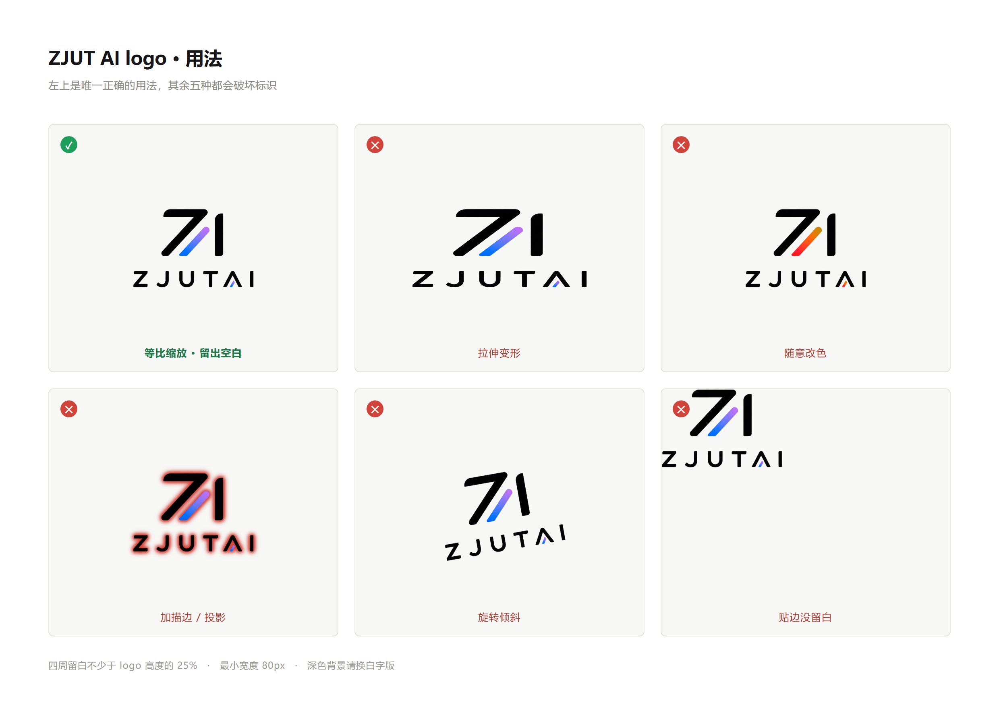

# 使用规范

## 1. 先看背景深浅

这是唯一一个「用错了会立刻出问题」的规则。

| 背景 | 用 | 不要用 |
| :--- | :--- | :--- |
| 深色、黑色、照片、彩色渐变 | 白字版 | 黑字版（看不见） |
| 白色、浅灰、米色、浅色照片 | 黑字版 | 白字版（看不见） |

判断不了背景深浅时，看这一块区域的平均亮度：低于 50% 用白版，高于 50% 用黑版。
背景深浅不均（比如一半亮一半暗）时，换一块背景，不要在 logo 下面垫色块。

## 2. 尺寸

| 场景 | 建议宽度 |
| :--- | :--- |
| 公众号封面 2.35:1 | 90–170 px |
| 公众号小图 1:1 | 90–150 px |
| PPT / 幻灯片封面 | 120–220 px |
| A4 海报（印刷） | 30–50 mm |
| 网页导航栏、邮件签名 | 28–40 px |

**最小宽度 80px。** 再小 `ZJUTAI` 字标会糊在一起。真需要更小时，
只用 `ZJ` 图形部分，不要硬缩整个横版。

**没有最大尺寸上限**，但要让 logo 明显小于画面，别占满整张图。
海报上 logo 通常占宽度 1/6 到 1/4。

## 3. 安全边距

logo 四周留出的空白 **不小于 logo 高度的 25%**。SVG 画布已包含透明安全边距，尺寸建议按标识的实际可见宽度计算。

```
┌─────────────────────────┐
│         ↕ 25%           │
│      ┌──────────┐       │
│  ←→  │   LOGO   │  ←→   │
│      └──────────┘       │
│         ↕ 25%           │
└─────────────────────────┘
```

不要贴边，不要压在复杂纹理、人物、文字上。背景太乱时，先在 logo 下方
垫一层柔和的暗角或模糊，再放 logo。

## 4. 不要这样



| 错误 | 为什么不行 |
| :--- | :--- |
| 拉伸 / 压扁 | 图形和字标的比例关系是设计定死的 |
| 改颜色 | 蓝紫斜杠和 `A` 的渐变是标识的一部分 |
| 加描边、阴影、发光 | 会破坏笔画干净利落的轮廓 |
| 旋转、倾斜 | 横版 logo 只能水平放置 |
| 加外框、圆角底片 | 需要区分背景就换 logo 版本，不要加底板 |
| 拆开使用 | `ZJ` 图形和 `ZJUTAI` 字标是一个整体，不要单独拿出来重组 |

## 5. 和别的标识放在一起

多个主办 / 协办 logo 并排时：

- **统一视觉高度**，不要统一宽度（不同 logo 长宽比不一样）
- logo 之间留出的间距等于单个 logo 高度的 50% 以上
- 排序按主办、承办、协办的级别，不要按 logo 大小
- 不要用一个框把多个 logo 圈在一起

## 6. 深色封面上放 logo

品牌白版 logo 放在照片或光效背景上时，如果背景在 logo 区域过亮：

1. 优先换一个更暗的区域
2. 其次在 logo 下方加一层柔和的径向暗角（半径约为 logo 宽度的 2.5 倍，不透明度 30–50%）
3. 不要给 logo 加描边或投影来「拉对比」

## 需要其他格式

仓库提供图形加 `ZJUTAI` 字标的黑字、白字透明 PNG 和 SVG。需要 AI / EPS 矢量源、中英全称横版、单色版或纯图形版，
请开 issue 说明用途和尺寸，我们按需补充。
